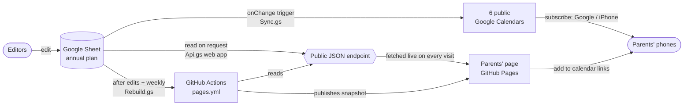

# נוער חלח״צ — youth events: sheet → calendars → website

The events of the youth in חלח״צ for the year, kept in **one Google Sheet** and published automatically to
**six public Google Calendars** and a **parents' website**:

**https://halhats-dev.github.io/noar-halhats/**

Nobody edits the calendars or the website by hand. Editors change the sheet; everything else follows within
seconds (calendars) to about a minute (website).

---

## How it fits together



| Part | Where | Job |
|---|---|---|
| **The sheet** | Google Drive of halhats@gmail.com, folder `vaadat_noar`: "תוכנית שנתית האיחוד החקלאי תשפז" | Single source of truth for all events |
| **Apps Script** (bound to the sheet) | source in [`apps-script/`](apps-script/) | Calendar sync, auto-sort, tick-box rules, public endpoint, site rebuilds |
| **Calendars** | Google Calendar of halhats@gmail.com, named `נוער חלחצ - <calendar>` | What parents subscribe to on their phones |
| **Endpoint** | Apps Script web app (URL in [`apps-script/deployment.json`](apps-script/deployment.json)) | Read-only JSON of the public fields, both tabs |
| **Website** | [`site/`](site/), built by [`.github/workflows/pages.yml`](.github/workflows/pages.yml) | Mobile-first Hebrew page for parents |

---

## 1. The Google Sheet

Tabs:

- **אירועי תנועה - איחוד חקלאי** – the movement's events (from the movement's annual plan PDF). Synced to the calendars and
  shown on the page with the movement's logo.
- **אירועי ועדה** – the local committee's own events. Same structure. Shown on the page; **not yet synced to the calendars**.
- **קישורים ליומנים** – subscribe links for each calendar (read-only).

Columns (identical in both event tabs):

| Col | Header | Content | Who fills it |
|---|---|---|---|
| A | חודש | month, e.g. "אוקטובר 2026" | formula |
| B | מתאריך | start date (date picker) | editor |
| C | עד תאריך | end date; empty = one day | editor |
| D | ימים | number of days | formula |
| E | יום בשבוע | weekday(s), e.g. "שישי–שבת" | formula |
| F | אירוע | event title | editor |
| G | יומן | which calendar (dropdown, 6 options) – also sets the row colour | editor |
| H | מתקיים | ✔ = happening. **Untick to cancel**: removed from calendar and page, row is struck through | editor (auto-ticked for new events) |
| I | יום מלא | ✔ = all-day (multi-day events are always all-day) | editor (auto in the committee tab) |
| J–K | שעת התחלה / שעת סיום | times, 08:00–20:00 in 30-min steps; default 17:00–20:00; blocked when all-day | editor |
| L | מזהה | **hidden** – permanent row id that links the row to its calendar event | script |
| M | סנכרון | **hidden** – fingerprint of what was last written to the calendar | script |
| N | מיקום | location; type `@` + place name for a Google Maps place chip | editor |
| O | תיאור האירוע | description (Ctrl+Enter for a new line) | editor |
| P | פרטי איש קשר | contact details – shown publicly; phone numbers become tap-to-call on the page | editor |

**Protection.** Only the owner (halhats@gmail.com) can edit the header row, the formula columns (A, D, E), the hidden
columns (L, M) and the links tab. Editors can edit B–C, F–K and N–P in rows 2–1000. Editors add events in the empty
rows at the bottom (they already carry the formulas and dropdowns) – they cannot insert or delete rows. To remove an
event: untick **מתקיים** (keeps it visible as cancelled) or clear its cells.

**Calendars** (`יומן`): שכבה צעירה, שכבה בוגרת, שכבת י״ב, טקסים וטיולים (events for everyone), רכזים, שנת שירות.

---

## 2. Apps Script (`apps-script/`)

One script project bound to the sheet. Files are loaded **in this order**, which matters (see *Gotchas*):

| File | What it does | Runs when |
|---|---|---|
| `Code.gs` | Shared column positions; `layoutOk_()` header check; tick-box rules: blocks/restores the times when **יום מלא** changes, auto-ticks **מתקיים** for new events, auto-sets **יום מלא** for multi-day committee events | `onEdit` (simple trigger, as the editing user) |
| `Sync.gs` | Mirrors the movement tab into the calendars: creates, updates, moves and deletes events; skips unchanged rows by fingerprint; adds the **סנכרון יומנים** menu | installable `onChange` trigger + every 4 hours + menu |
| `Sort.gs` | Sorts both event tabs by start date, end date and title, **3 minutes after the last change** (so a row being typed doesn't jump away); then re-applies the time rules and asks for a site rebuild | one-off trigger set after each change; menu **מיין עכשיו** |
| `Api.gs` | `doGet` web app: returns only the public fields of happening events from both tabs as JSON (60-second cache) | every page visit and every site build |
| `Rebuild.gs` | Asks GitHub to rebuild the site: after edits settle (at most once per 10 minutes; a too-soon request is deferred, never dropped) and every Sunday 05:00 | from `Sort.gs`; weekly trigger |

How the sync knows which calendar event belongs to which row: each row has a permanent id in column **L**; the calendar
event carries the same id as a tag (`sheetRowId`). Column **M** stores a fingerprint of what was written, so unchanged
rows cost nothing. Rows that are incomplete (no date, title or calendar), unticked, or deleted lose their calendar event.
The sync only touches events it created.

Safety: every script first checks the header row (`H1 = מתקיים`, `I1 = יום מלא`, `L1 = מזהה`) and does nothing if the
layout changed. Sort and sync share one lock, because the sync writes ids by row position.

---

## 3. The calendars

Six public calendars (anyone can view, nobody but the owner can edit). The links tab in the sheet has, per calendar:
an "add to Google Calendar" link, a web view / embed link, and an iCal link (iPhone, Outlook). Google Calendar
subscribers see changes almost immediately; iCal subscribers when their app refreshes (can take hours).

---

## 4. The website (`site/`)

| File | Role |
|---|---|
| `template.html` | The whole page: HTML, CSS and JS in one file (RTL, Hebrew, mobile-first, light/dark) |
| `fetch_data.py` | Downloads the endpoint JSON into `data.json` (no credentials) |
| `build.py` | Inlines `data.json` (the **snapshot**) and the endpoint URL into the template → `dist/index.html` + `dist/img/` |
| `img/` | `hero.jpg` (CC0 stock photo), `logo-ihud.png` (movement logo); sources in `img/CREDITS.txt` |

On every visit the page shows the built-in snapshot immediately, then fetches the endpoint and re-renders with live
data. If the endpoint fails or takes over 12 seconds, a notice says a saved copy from <date> is shown.

What parents see: a countdown card with **all** events of the next event day; grade chips (remembered per device; staff
calendars hidden behind a link); the current month in full and later months as compact collapsible cards; per-event
"add to my calendar" links, Google Maps location links and expandable details; subscribe buttons per calendar; a top menu.

Run it locally:

```bash
cd site && python3 fetch_data.py && python3 build.py   # then open site/dist/index.html
```

Append `?demo` to the URL to fill the next event with sample location/description/contact text (for reviewing the design).

---

## 5. Publishing (`.github/workflows/pages.yml`)

The workflow runs `fetch_data.py` + `build.py` and deploys `site/dist` to GitHub Pages. It runs:

- on every push to `main`,
- when the sheet asks for it (`Rebuild.gs`, via `workflow_dispatch`): ~3 minutes after edits settle, and Sundays 05:00,
- daily at 06:17 Israel time (GitHub pauses this schedule after 60 days without commits – the sheet-triggered runs above
  keep the snapshot fresh regardless),
- manually from the Actions tab.

It needs **no secrets**: it only reads the public endpoint.

---

## 6. Accounts and secrets

Only the **halhats** accounts are used: Google = halhats@gmail.com, GitHub = halhats-dev.

| Secret | Kept in | Used for |
|---|---|---|
| Google OAuth token of halhats@gmail.com | local machine, `~/.config/gcloud/noar-halhats/token.json` (outside the repo) | `tools/` – deploying the Apps Script, one-off sheet changes |
| GitHub fine-grained token (repo `noar-halhats` only, *Actions: read and write*) | Apps Script → Script properties → `GITHUB_TOKEN` (backup copy in the same local folder) | `Rebuild.gs` triggering the workflow |
| gh CLI login of halhats-dev | local machine, `~/.config/gh/hosts.yml` | pushes (via the repo-local git credential helper) and `gh` commands |

The repo itself contains **no secrets**. A README in `~/.config/gcloud/noar-halhats/` describes each local file.
Local-only, git-ignored: `CLAUDE.md` and `.claude/` (assistant instructions and an account guard), `site/dist/`,
`site/data.json`.

This clone is pinned to halhats-dev: commits are authored as `halhats-dev` (no-reply address), and the remote URL and
the repo-local credential helper only ever use that account's token.

---

## 7. Common tasks

**Change an Apps Script file** – edit it in `apps-script/`, then:

```bash
python3 tools/deploy_apps_script.py              # push code + new web app version (same URL)
python3 tools/deploy_apps_script.py --code-only  # push code only; the web app keeps its version
```

Use `--code-only` when the change needs a **new Google permission**: installed triggers pause until the owner opens the
script editor, runs any function and approves; redeploy the web app after that. Commit the change to git as well.

**Change the page** – edit `site/template.html`, check locally, commit and push; the workflow publishes in ~1 minute.

**Add or move a sheet column** – the scripts address columns by position. Update the positions in `Code.gs` (`C_*`) and
`Sync.gs` (`COL`), the header check (`EXPECTED_HEADERS`), `SORT_LAST_COL`, and `Api.gs` if the field is public; deploy the
code **first** (the header check pauses everything until the sheet matches), then change the sheet.
`tools/add_happening_column.py` is the worked example.

**Force a sync / sort** – sheet menu **סנכרון יומנים → סנכרן עכשיו / מיין עכשיו**.

**Replace the GitHub token** – create a new fine-grained token (as above), put it in Script properties as `GITHUB_TOKEN`,
run `setupGithubRebuild` in the script editor; the log should end with `(204)`.

**First-time setup of the script triggers** – in the script editor run `setup` (`Sync.gs`: change trigger, 4-hour sync,
first full sync) and `setupGithubRebuild` (`Rebuild.gs`: weekly rebuild, test request).

---

## 8. Limits and gotchas

- **Apps Script runs files in project order.** A top-level constant must not use one defined in a later file (an
  alphabetical upload once broke the sync). `tools/deploy_apps_script.py` pins the order.
- **Free Google quotas** (gmail.com account): 90 minutes/day of triggered runtime is the only one within reach – a day with
  hundreds of separate edits could pause the calendar sync until the next day (it then catches up). Page visits don't count
  toward it; 30 simultaneous endpoint calls is the burst limit.
- **Calendar sync window:** the sync looks after events dated 2026-01-01 to 2028-12-31 (`SYNC_FROM`/`SYNC_TO` in `Sync.gs`).
- **Committee events** are on the page but not in the calendars yet.
- **Headers** H1, I1 and L1 must keep their names (`מתקיים`, `יום מלא`, `מזהה`) – they are the layout check.
- **Pasting** into the sheet can strip dropdowns and tick boxes from those cells – paste values only (Ctrl+Shift+V).
- **Contact details** typed into the sheet are public (page, endpoint, and the snapshot in this repo's builds).

## Repository layout

```
.github/workflows/pages.yml   build + deploy to GitHub Pages
apps-script/                  the sheet's Apps Script (deployed with tools/deploy_apps_script.py)
  appsscript.json             manifest (time zone, web app access)
  deployment.json             web app deployment id + public URL
site/                         the parents' page (template + build scripts + images)
tools/                        local maintenance scripts (need the halhats Google token)
```
